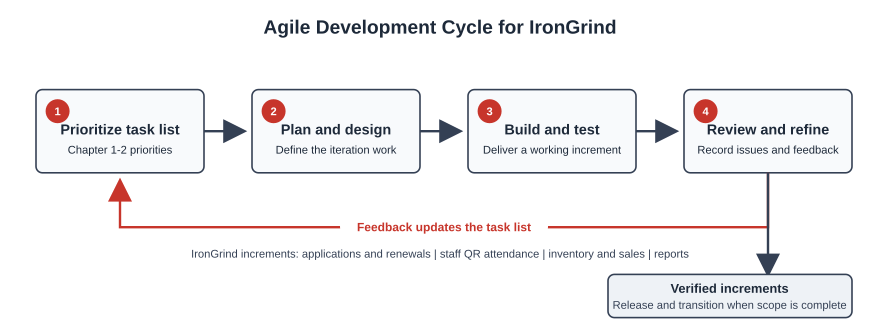
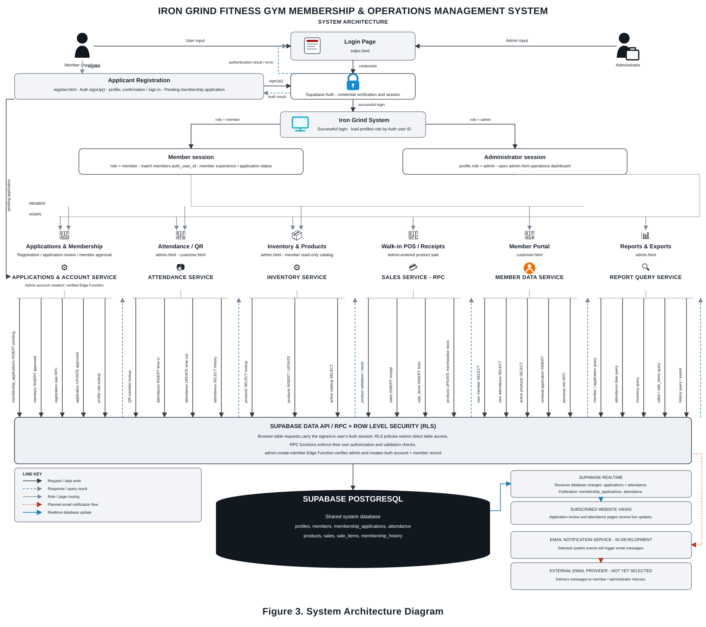
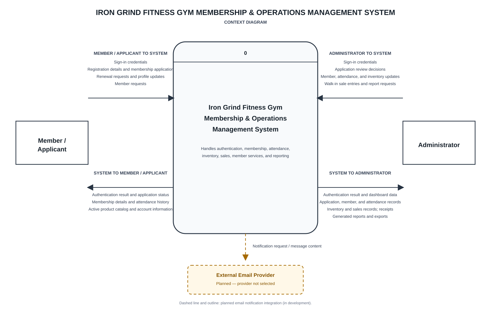
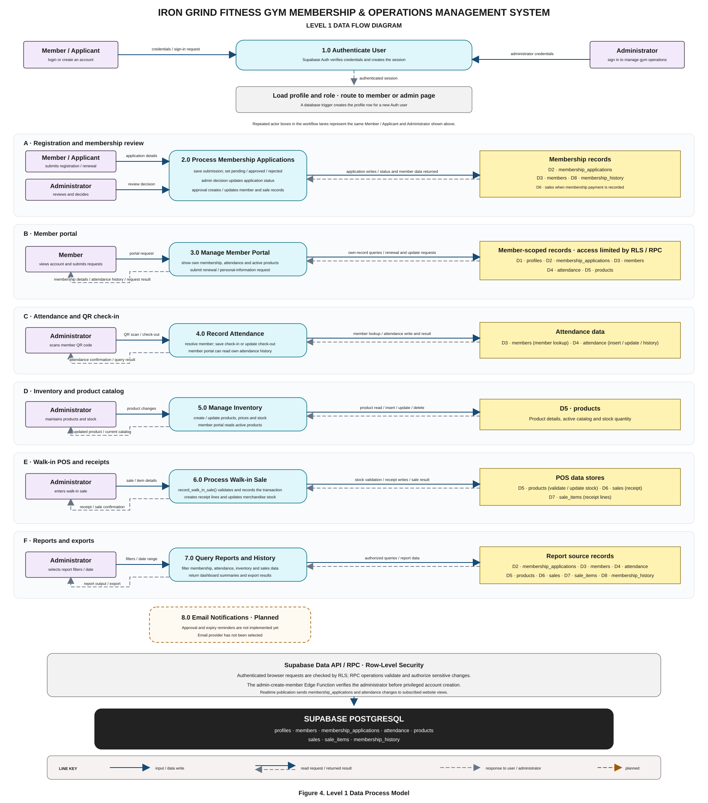
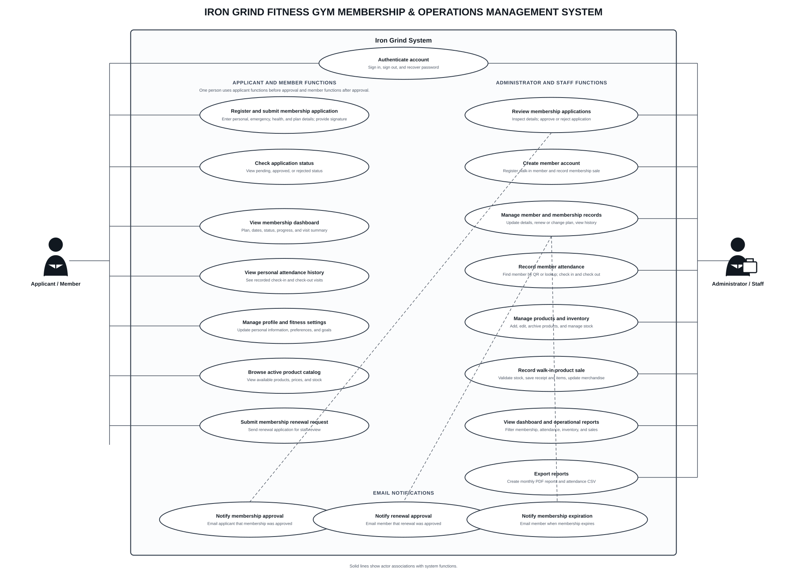
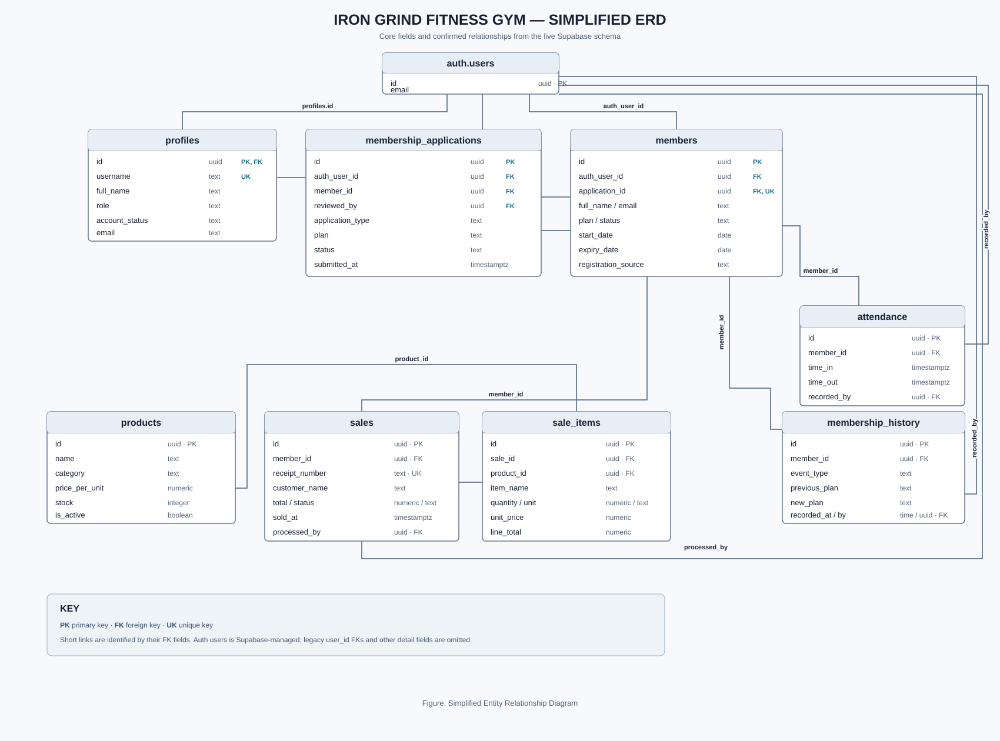

# CHAPTER 3

# RESEARCH METHODOLOGY

This chapter discusses the methodology used to develop **IronGrind: A Web-Based Fitness Gym Membership and Operations Management System for Iron Grind Fitness Gym in Purok Mangga, Sulongon, Dapitan City, Zamboanga del Norte**. It describes the development process, system requirements, design, data organization, and evaluation procedures. The system is intended to organize membership applications and records, membership periods and renewals, staff-recorded attendance, products, sales, and reports. Its development is organized using Agile, with work planned and delivered incrementally. Proposed evaluation activities are distinguished from results that have not yet been collected.

### System Development Methodology

**Figure 1.** Agile Methodology.

Agile is an iterative system-development approach in which stakeholder needs are gathered and prioritized, selected work is developed and tested in increments, and review results inform the next iteration. Figure 1 has two connected parts. The circular cycle places Develop, Test, and Review around the IronGrind project name: the team builds a selected increment, checks it against its requirements, and uses review feedback to refine the next increment. The lower project flow shows Data Gathering, Plan, and Design before Launch. This lower row represents the project's overall progression; Launch follows verification of the required increments rather than occurring at the end of every cycle. The work is organized around the gym's applicant/member and administrator workflows. The figure describes the Agile activities used to organize the project and does not prescribe a particular framework or iteration length.

### Requirements Planning

Requirements planning organizes the workflows and scope described in Chapters 1 and 2 into a prioritized task list. Work begins with account access and membership applications, followed by staff review, member access, attendance, inventory, sales, and reporting. Each selected requirement is assigned acceptance criteria so the increment can be checked during construction. Privacy and authorization requirements apply throughout development because the system handles personal and health-related information.

### User Design

For each iteration, the relevant user workflows, page layouts, forms, reports, data relationships, and role permissions are designed or refined. The design distinguishes pending applications from approved member records, keeps attendance as a separate operational record, and stores sales with their itemized lines. The architecture, use-case, and data-flow figures in this chapter summarize the system design.

### Prototypes

The system prototype is an interactive, browser-based version of the gym workflows. Applicants use the sign-in and registration pages to enter the application workflow. Members use the member portal to review membership information, display their QR code, view attendance history, and submit an eligible renewal request. Administrators use the dashboard to review applications and manage membership, staff-scanned attendance, products, sales, receipts, and reports. The prototype uses Supabase Auth and configured database services for supported operations. Its key pages are listed in the Forms section. Deployment and operational readiness are separate implementation activities.

### Construction

Selected requirements are implemented in the HTML, CSS, and JavaScript client and the Supabase authentication and PostgreSQL services. Database policies and functions support authorization and operational transactions. Each increment is checked against its acceptance criteria. Issues identified during verification are corrected or returned to the prioritized task list for a later increment.

### Implementation

The implementation phase follows verification of the required increments. It includes configuring the website and Supabase project for the intended environment, applying the approved access policies, preparing administrator accounts, and orienting staff to the supported workflows. Deployment and user-orientation outcomes are reported after those activities are completed.

## Requirement Specifications

This section presents the operating context and the functional, input, output, software, hardware, and nonfunctional requirements for IronGrind. These specifications describe the system represented by the current project files.

### Study Setting and Intended Users

The system is intended for Iron Grind Fitness Gym in Purok Mangga, Sulongon, Dapitan City, Zamboanga del Norte. Its intended users are applicants, members, authorized administrators, and walk-in customers served by staff. The database defines `admin` and `member` profile roles; it does not define a separate staff role.

### Functionality Requirements

The functional requirements describe the operations available to applicants, members, and authorized administrators. They cover sign-in, application review, membership, attendance, inventory, sales, and reports.

#### Table 1. Functional Requirements

| ID | Requirement | Description |
| --- | --- | --- |
| FR-01 | Authentication and access | Users authenticate through Supabase Auth. Administrator and member access is governed by profile roles and database authorization policies. |
| FR-02 | Online application | An applicant submits registration details through the website. The application is stored for administrator review and is not automatically an active membership. If the applicant attempts to log in while the application is pending, the website displays the pending status. |
| FR-03 | Application review | Authorized staff view, approve, or reject registration and renewal applications. The decision and application status are retained. |
| FR-04 | Membership management | Authorized staff manage member records, plan and membership dates, status, payment information, and membership lifecycle records. |
| FR-05 | Member portal | An approved member views membership status and progress, personal attendance history, and a QR code; updates are limited to supported account and personal-information fields. |
| FR-06 | Renewal request | An eligible member can submit a renewal request for staff review. A request is not an automatic renewal. Chapter 2 specifies the five-calendar-day renewal window before and including the current expiry date. |
| FR-07 | Attendance | Staff scan a member's QR code to record check-in and check-out. Members can view their own attendance history; the member does not record their own attendance. |
| FR-08 | Product and inventory management | Authorized staff maintain products and inventory. Supplements use gram-based quantities; merchandise uses item quantities and stock tracking. |
| FR-09 | Sales and receipts | Staff record in-person product and membership sales for members or walk-in customers. The system stores a sale record and its line items and supports receipt/report views. |
| FR-10 | Operational reports | Authorized staff view and print or save the available membership, member-status, archive, payment, attendance, renewal, inventory, and sales reports. Report contents depend on the records entered into the system. |

### Input Requirements

#### Table 2. Input Requirements

Input requirements identify the information supplied to the system by applicants, members, and authorized administrators or recorded through staff actions. Required fields depend on the selected workflow.

| Input requirement | Description |
| --- | --- |
| Account credentials | Email and password are submitted to Supabase Auth. |
| Registration or renewal application | Applicant and plan details, contact and emergency-contact information, goals, health declarations, and signature where collected by the form. |
| Attendance action | Staff scans a member QR code and records check-in or check-out. |
| Product and inventory update | Administrator enters product details, price, unit, and merchandise stock quantity where applicable. |
| Sale transaction | Staff enters customer type and name, products or membership, quantities, and transaction details. |
| Report request | Administrator selects a report type and available filters or date range. |

### Output Requirements

#### Table 3. Output Requirements

Outputs are the responses and records produced after the system validates a request and processes the stored data. Email notifications remain planned and are not currently sent.

| Output requirement | Description |
| --- | --- |
| Authentication and login result | Role-appropriate routing or an authentication error; pending applicants see their application status during login. |
| Application and membership result | The recorded application status and, after staff review, the decision and updated membership information. |
| Member portal information | Membership details, QR code, personal attendance history, and active product catalog permitted for the member. |
| Attendance confirmation | Confirmation of staff-recorded check-in/check-out and permitted attendance history. |
| Receipt | Sale details, line items, quantities, prices, customer information, and total. |
| Administrative reports | Membership, member status, archives, payments, attendance, renewals, inventory, and sales data based on stored records. |
| Planned: email notifications | Application or renewal decisions and expiry reminders are planned; email delivery is not currently available. |

### Software Requirements

#### Table 4. Software Requirements

| Software | Requirement or purpose |
| --- | --- |
| Web browser | Current browser with JavaScript enabled for applicant, member, and administrator workflows. |
| Frontend | HTML, CSS, and JavaScript files served by a compatible web host. |
| Backend services | Supabase Auth and PostgreSQL, with the project schema, Row Level Security policies, and required database functions configured. |
| Edge Function | Supabase Edge Function runtime for administrator-authorized member account creation. |
| Development environment | Node.js 20 or later to run the repository's local static-file server. This local server is for development, not the production database backend. |
| QR scanning | Browser camera permission and a secure HTTPS origin for production QR scanning. |

### Hardware Requirements

#### Table 5. Hardware Requirements

| User or component | Requirement |
| --- | --- |
| Administrator or staff | Desktop computer, laptop, or compatible mobile device with a current browser and internet access. A camera-enabled device is needed when staff scan member QR codes. |
| Applicant or member | Smartphone, tablet, laptop, or desktop computer with a current browser and internet access. |
| Web hosting | Hosting capable of serving the static HTML, CSS, JavaScript, and image assets over HTTPS. Supabase provides the separate authentication and database services. |

### Nonfunctional Requirements

#### Table 6. Nonfunctional Requirements

| Area | Requirement |
| --- | --- |
| Platform | The application is accessed through a modern browser with JavaScript enabled. The user interface is implemented as web pages and client-side scripts. |
| Connectivity | Authenticated database-backed functions require an internet connection to reach Supabase. |
| QR scanning | The staff device requires a camera and browser permission to scan QR codes. Production camera access should be served from a secure HTTPS origin. |
| Access control | Database access is restricted through authenticated roles and PostgreSQL Row Level Security policies. Privileged account creation is routed through the administrator-verified Edge Function. The deployed configuration must be tested before use. |
| Data handling | The application stores contact, emergency-contact, and health-related information. Access and retention practices should follow the gym's approved privacy procedures and applicable law. This description is not a certification of legal compliance. |
| Availability | Users depend on the availability of the website host, internet connection, and Supabase services. Operational backup and recovery procedures must be defined for the deployed environment. |

## System Design

### System Architecture Diagram

**Figure 2.** System architecture of IronGrind.

Figure 2 is a component view of the system and shows where each kind of work takes place. On the user side, applicants and members use the login, registration, and member pages; administrators use the dashboard. Supabase Auth verifies credentials and establishes a session, while the application uses the profile role to route a signed-in person to the appropriate interface. Inside the browser application, the labeled modules group related functions: Applications and Membership handle submissions and staff decisions; Attendance and QR supports staff scans; Inventory and Products maintains the catalog; Walk-in POS and Receipts records transactions; Member Portal presents a member's permitted information; and Reports and Exports prepares administrative summaries. Requests go to Supabase through its Data API or database RPC functions. The PostgreSQL database contains the application records, and Row Level Security (RLS) policies plus function-level checks restrict access to them. Realtime sends changes from `membership_applications` and `attendance` to subscribed website views. The email component is marked as in development because no external provider is selected. The Node.js server in the repository serves static files for local development and is not the production database backend.

### Data Process Modeling

Data process modeling describes how information enters IronGrind, which processes handle it, where records are stored, and what results are returned to applicants, members, and administrators. The model is based on the current Supabase schema and implemented workflows. Email notification is shown only as a planned feature.

#### Diagrams

The diagrams that follow present the system at different levels. The context diagram defines the system boundary and external exchanges. The Level 1 data-flow diagram expands the system into processes and stores. The use-case diagram groups functions by actor, and the ERD describes the database relationships that support those functions.

##### Context Diagram

**Figure 3.** System context diagram of IronGrind.

Figure 3 sets the boundary around IronGrind as a single system, without showing its internal modules or database tables. Applicants and members send credentials, registration or renewal details, and supported profile requests into that boundary. IronGrind returns authentication results and the membership, attendance, or active catalog information their role permits. Administrators send review decisions, member and product updates, sale entries, and report filters; the system returns updated records, receipts, and reports. A walk-in customer is represented through the staff-entered purchase rather than a direct system account. Supabase Auth and Supabase data services appear outside the application boundary because they provide authentication and database services to the website. The email exchange is planned and should be read as a future integration, not a current system output.

##### Data Flow Diagram

**Figure 4.** Level 1 data-process model for IronGrind.

Figure 4 decomposes the single IronGrind system from Figure 3 into numbered processes and named data stores. External actors provide inputs to the process that handles them: credentials go to authentication; application details and staff decisions go to application processing; member requests go to the portal; QR scans go to attendance; product changes go to inventory; and customer and item details go to walk-in sales. The report process reads the operational stores to prepare summaries. The data stores D1–D8 correspond to profiles, membership applications, members, attendance, products, sales, sale items, and membership history, as listed in the Data Stores table. Arrows between processes and stores distinguish information read from information written; arrows between a process and an actor represent the corresponding request or response. The figure's email process is explicitly planned only: the current system has no configured email provider and does not send these messages. Together, this diagram explains the record flow in more detail than the context diagram, while the tables below define each process and store in text.

### Data Process Explanations

The Level 1 diagram can be read as a sequence of related responsibilities. Each process validates its input, uses only the records needed for its task, and returns the corresponding result.

**1.0 Authenticate User.** Supabase Auth verifies submitted credentials and provides the authenticated session. The application reads the associated profile role to route the account to the member or administrator interface. Pending applicants receive an application-status response; they are not treated as approved members.

**2.0 Process Membership Applications.** The system records registration or renewal details in the applications store. An authorized administrator reviews the request. Approval creates or updates the member record and records the associated transaction where configured; rejection updates the application status.

**3.0 Manage Member Portal.** A signed-in member requests permitted membership, attendance, catalog, or profile information. The system returns records allowed for that member and stores a renewal request for staff review.

**4.0 Record Attendance.** Staff scan a member QR code. The system resolves the member and either records a check-in or closes the member's open visit. The QR code identifies a member for staff use; it does not grant entry by itself.

**5.0 Manage Inventory.** An authorized administrator creates, edits, or archives product records. Supplement prices and quantities use gram units; merchandise uses item units and tracked stock. The active catalog is returned to permitted views.

**6.0 Process Walk-in Sale.** Staff enter the customer and selected product. The system validates product availability, records a sale header and itemized line, updates merchandise stock according to the configured transaction, and provides receipt details.

**7.0 Query Reports and History.** An administrator selects a report and available filters. The system reads the relevant membership, attendance, inventory, sales, or history records and returns the corresponding view or export.

**8.0 Email Notifications (planned).** Approval and expiry events may be used by a future notification integration. No external provider is configured, so this process currently produces no email output.

### Operational Workflow Details

The numbered processes above summarize the flow. The following workflow descriptions state the initiating actor, the information checked, the records affected, and the observable result. They are intended to guide implementation review and functional verification.

#### Account Access Workflow

An applicant, member, or administrator submits credentials through the sign-in page. Supabase Auth validates the credentials and returns an authenticated session. The application then retrieves the profile associated with that Auth identity and uses its stored role for navigation and role-specific actions. An applicant with a pending registration is not treated as a member merely because an Auth account exists. If the credentials are invalid, the Auth service is unavailable, or the profile cannot be retrieved, the system returns an error or status message and does not claim that access succeeded. Database access remains subject to RLS even after the client routes to a page.

#### New Membership Application Workflow

An applicant creates an account and completes the application form. The client checks required fields and basic formatting, including the supported contact and password formats. The submission includes requested plan information and, where collected, demographic, emergency-contact, health-declaration, goal, and signature values. The application is associated with the Auth identity and begins in pending status. The member record is not considered active while this review is pending. An authorized administrator opens the registration queue and checks the submitted details. Approval creates or links the member record and records the applicable membership transaction; rejection updates the application review state. Review time and reviewer identity are stored when available. A repeat submission or interrupted approval should be checked against existing records to avoid creating duplicate member links or receipt records.

#### Renewal Request and Approval Workflow

An existing member opens the renewal request control when eligible under the configured renewal window. The client submits the selected plan and membership details as an application associated with the existing member. That request remains pending while the current membership period remains the authoritative member record. An administrator reviews the renewal queue and approves or rejects it. On approval, the system records prior and new plan dates and prices in membership history, updates the member's current plan and expiry, and records the renewal sale and item line. The transaction should be written in a retry-safe order so an interrupted request can be resumed without charging twice or leaving inconsistent membership dates. The report distinguishes a recorded receipt from a legacy approved request for which a receipt row is missing.

#### Staff Attendance Workflow

Staff open the attendance section and grant camera permission to the browser. The scanner decodes the member identifier and resolves it against the loaded member records or Supabase. The process first checks for an open visit for that member. If one exists, the scan records checkout; otherwise, the membership expiry is checked before a new check-in is created. The stored row includes the member reference, timestamps, and the staff identity where supported. Repeated checkout requests must not overwrite a completed visit. If QR resolution, network access, or the database write fails, staff receive a clear failure message and can retry. The attendance list and dashboard are refreshed from the resulting record.

#### Inventory Maintenance Workflow

An administrator creates or edits a product by entering its name, category, unit price, and applicable variant or stock data. Validation rejects an empty name, invalid price, or invalid stock value. Category determines the selling unit: supplements are per gram, while merchandise is per item and has countable stock. An archive action changes the product's active state and records when it was archived; archived products are removed from new sale choices but remain visible in the archive report. A product image is optional and is resized by the client before it is persisted. The browser interface is not the authorization boundary; database policies must also limit product mutations to administrators.

#### Counter Sale Workflow

Staff enter the customer name, choose an active product, and specify its quantity. Merchandise quantities are whole items and must not exceed the available stock. Supplement quantities are gram amounts and can use decimal precision. The database transaction records a receipt header and its sale line; configured sale functions validate current stock and update merchandise quantities. Once the saved result is returned, the interface updates the sale list, inventory summary, and receipt preview. If a write fails, a receipt should not be shown as completed. Receipt number uniqueness and transaction-level validation help prevent duplicate or inconsistent sale records.

#### Membership Plan Change Workflow

An administrator selects a current member and a replacement plan, reviews the new charge, and submits the change. The system validates the member link, plan, positive price, and effective dates. It stores a plan-change history event with the prior plan and dates and the new plan and dates, then updates the current member row. Where the workflow records a charge, it also creates a membership sale and receipt line. The displayed confirmation follows successful database completion. In the local demonstration flow, corresponding browser storage records are updated; the Supabase flow uses the configured database function and should be used for shared production records.

#### Report Generation Workflow

An administrator selects a report type and, for monthly exports, a valid year and month. The report process reads the applicable data stores and formats the selected fields. Date-based reports group or filter records using the stored event date and display times in the local gym context. Inventory and member-status output represent current values unless a historical snapshot is available. PDF and ZIP generation depends on the required browser libraries loading successfully. The interface reports an unavailable generator or invalid month rather than claiming a file was created.

##### Use-Case Diagram

**Figure 5.** Use-case diagram of IronGrind.

Figure 5 describes the system from each actor's point of view. The actor lines connect a role to the use cases that role may initiate; the system boundary encloses the functions provided by IronGrind. Applicants can register and access the application/login workflow. Members can use the member portal, view their membership and attendance information, and submit renewal requests when eligible. Administrators review applications and manage members, attendance, products, sales, and reports. Walk-in customers are not shown as authenticated users because staff enter their sale details at the counter. The diagram expresses available role interactions; it does not imply that a member can approve an application or record their own attendance.

### Use-Case Explanations

The use cases in Figure 5 are grouped by the actor's role. The associations show which actor can initiate each function; database policies and server-side checks still control access to the underlying records.

**Applicant.** An applicant creates an account and submits a membership application. The application remains pending until an administrator reviews it.

**Member.** A member signs in to view permitted membership details, the issued QR code, personal attendance history, and the active catalog. An eligible member may submit a renewal request, which remains subject to staff review.

**Administrator.** An administrator reviews applications and manages member records, staff-scanned attendance, products, sales, receipts, and operational reports.

**Walk-in customer.** A walk-in customer does not need a system account. Staff enter the customer's purchase in the point-of-sale workflow and provide a receipt.

##### Entity Relationship Diagram

**Figure 6.** Entity relationship diagram of IronGrind.

Figure 6 is a relational view of the core tables, rather than a flow of screens or activities. Each box names a table and shows selected fields; PK marks a primary key, FK marks a foreign key, and UK marks a unique field or link. The line ends indicate relationship cardinality: for example, one member may have many attendance events and membership-history records, while each such record points back to one member. A sale may belong to a member or to a walk-in customer, and its itemized lines are stored separately in `sale_items`; a line can retain its item description even when it has no linked product. `auth.users` is managed by Supabase and is shown to explain identity links, while `profiles` stores application role information. The `members.auth_user_id` link is nullable and unique, so a member can exist without a linked Auth identity and a single Auth user cannot be linked to multiple member rows. Application and member links also allow pending submissions to exist before they are connected to an approved member. The simplified ERD omits secondary fields to keep the relationships readable; consult the data dictionary and current schema for the full field list.

### Entity and Relationship Explanations

The ERD is a database structure diagram. Primary keys identify rows; foreign keys connect records; unique keys prevent duplicate identity or receipt links. Optional links are nullable, so a record can exist before an associated account or member has been linked.

**Authentication and profiles.** Supabase manages authentication identities in `auth.users`. The `profiles` row stores the application role and account information. A profile's identifier corresponds to its Auth user.

**Applications and members.** `membership_applications` stores registration and renewal requests and their review state. An application may refer to a member after the account is approved or when it represents an existing member's renewal. `members` stores approved membership information. The nullable unique `members.auth_user_id` link permits no more than one member row per Auth user.

**Attendance and membership history.** Each attendance row refers to the member whose visit it records; a member can have multiple visits. Membership history stores lifecycle events such as expiration, renewal, and plan change, with prior and new values where available.

**Sales, sale items, and products.** A sale stores the receipt-level customer, date, status, and total. Its itemized details are stored in `sale_items`. A line may refer to a product, while the item name and price are retained on the line for the transaction record. A member sale may link to a member; a walk-in sale may have no member link.

These links support the reports and workflows described in the process model. The simplified diagram omits secondary fields for readability; the Data Dictionary lists the principal fields and their purposes.

### Data Processes

| Process | Input | Data stores or services used | Output |
| --- | --- | --- | --- |
| 1.0 Authenticate User | Member/applicant or administrator credentials | Supabase Auth; D1 `profiles` for role lookup | Authenticated session and role-based routing, or an authentication error. |
| 2.0 Process Membership Applications | Registration or renewal details; administrator approval or rejection | D2 `membership_applications`; D3 `members`; D8 `membership_history`; D6 `sales` when a membership transaction is recorded | Updated application status, member record and related transaction result. |
| 3.0 Manage Member Portal | Member requests, supported profile updates, renewal submissions | D1 `profiles`; D2 `membership_applications`; D3 `members`; D4 `attendance`; D5 `products` | Member's permitted membership, attendance, and active product information; renewal or update result. |
| 4.0 Record Attendance | Staff QR scan and check-in/check-out action | D3 `members` for member lookup; D4 `attendance` for attendance records | Saved attendance event and confirmation; attendance history for permitted member access. |
| 5.0 Manage Inventory | Administrator product, price, category, or stock changes | D5 `products` | Updated product and inventory records; active catalog data for members. |
| 6.0 Process Walk-in Sale | Staff-entered customer and sale-item details | D5 `products` for validation and stock; D6 `sales`; D7 `sale_items` | Validated sale, receipt details, and applicable merchandise stock update. |
| 7.0 Query Reports and History | Administrator report type and filters, including date range | D2 `membership_applications`; D3 `members`; D4 `attendance`; D5 `products`; D6 `sales`; D7 `sale_items`; D8 `membership_history` | Dashboard summaries, filtered report data, and available exports. |
| 8.0 Email Notifications (planned) | Future approval or expiry events | No live notification store or external provider configured | No email output is currently produced; this process remains planned. |

### Data Stores

| ID | Data store | Contents |
| --- | --- | --- |
| D1 | `profiles` | Authenticated user's application profile and role. |
| D2 | `membership_applications` | Registration and renewal submissions, review status, and decision information. |
| D3 | `members` | Approved member and membership records. |
| D4 | `attendance` | Staff-recorded member check-in and check-out events. |
| D5 | `products` | Product catalog, categories, prices, units, and merchandise stock. |
| D6 | `sales` | Transaction headers and receipt details, including membership sales where recorded. |
| D7 | `sale_items` | Itemized transaction lines. |
| D8 | `membership_history` | Expiration, renewal, and plan-change events. |

## Overall Description

IronGrind is a browser-based membership and operations system for applicants, members, and administrators. Users submit requests through the website; Supabase Auth manages authentication and sessions; authorized data requests pass through the Supabase Data API or database RPC functions; and PostgreSQL stores operational records. RLS and function-level checks restrict access. The system supports application review, member records, staff-recorded attendance, inventory, sales and receipts, and administrative reports. Realtime subscriptions currently cover membership applications and attendance. Email notifications remain planned and are not operational.

## Data Dictionary

This data dictionary summarizes the public-schema fields and relationships defined in the project SQL. Supabase Auth manages credentials separately from these application tables.

| Entity | Key fields and data types | Purpose and relationships |
| --- | --- | --- |
| `profiles` | `id` UUID (PK, Auth FK); `email`, `username`, `full_name`, `role`, `account_status` TEXT; timestamps | User profile and role used by the application. `username` is unique. |
| `members` | `id` UUID (PK); `auth_user_id` UUID (nullable, unique Auth FK); `application_id` UUID (nullable, unique FK); `full_name`, `email`, `username`, `mobile` TEXT; `date_of_birth` DATE; `age` SMALLINT; `height`, `weight_kg` NUMERIC; `height_unit`, `sex`, `plan`, `status`, `registration_source` TEXT; `emergency_contact` JSONB; `plan_price`, `paid` NUMERIC; membership dates; `fitness_goals`, `health_conditions` TEXT[]; `other_medical_conditions`, `signature_path` TEXT; timestamps | Approved member and membership record. Referenced by applications, attendance, sales, sale items, and membership history. |
| `membership_applications` | `id` UUID (PK); `auth_user_id` UUID (nullable Auth FK); `member_id` UUID (nullable FK); `application_type`, `status`, applicant and plan details; demographic, health, and signature fields; submission/review timestamps; `reviewed_by` UUID (FK to `profiles`) | Registration and renewal requests and their review state. `member_id` can be empty before a member is linked. |
| `attendance` | `id` UUID (PK); `member_id` UUID (FK); `time_in`, `time_out`, `created_at` TIMESTAMPTZ; `recorded_by` UUID (Auth FK) | Staff-recorded check-in and check-out. A member may have multiple attendance records. |
| `products` | `id` UUID (PK); `name`, `category`, `unit`, `size`, `image_path` TEXT; `price_per_unit` NUMERIC; `stock` INTEGER; `is_active` BOOLEAN; timestamps | Product catalog and inventory. Supplements use gram units; merchandise uses item units and stock. |
| `sales` | `id` UUID (PK); `receipt_number` TEXT (unique); `customer_type`, `customer_name`, `status` TEXT; `member_id` UUID (nullable FK); `total` NUMERIC; `sold_at` TIMESTAMPTZ; `processed_by` UUID (Auth FK) | Sale header and receipt information. A sale may be associated with a member or a walk-in customer. |
| `sale_items` | `id` UUID (PK); `sale_id` UUID (FK); `product_id` UUID (nullable FK); `item_name`, `category`, `unit` TEXT; `quantity` NUMERIC; `unit_price`, `line_total` NUMERIC | Itemized sale lines. Product reference can be null; item name and price are stored on the sale line. |
| `membership_history` | `id` UUID (PK); `member_id` UUID (FK); `event_type`, previous/new plan, `notes` TEXT; previous/new prices NUMERIC; previous/new dates DATE; `recorded_at` TIMESTAMPTZ; `recorded_by` UUID (Auth FK) | Expiration, renewal, and plan-change history for a member. |

### Detailed Field Reference

The following field reference expands the summary above. It describes the principal fields in the project schema and their role in the system. `PK` identifies a row, `FK` connects it to another table or Auth identity, and `UK` denotes a uniqueness rule. A nullable field may be absent when its value is not yet known or does not apply. Database defaults and checks are noted where they affect stored values. Supabase Auth credentials are managed in the separate `auth.users` schema and are not repeated here.

#### `profiles` — Account Profile and Authorization

The profile row extends the Auth identity with information used by the application. Its `id` shares the Auth user's UUID, so the profile is created and removed in step with the corresponding identity. The role is constrained to the application roles `admin` and `member`; the role is not taken from arbitrary signup input. Profile data supports role-aware navigation and database policies.

| Field | Type | Key / rule | Description |
| --- | --- | --- | --- |
| `id` | UUID | PK, FK to `auth.users.id`, cascade delete | Stable identifier for the authenticated profile. |
| `email` | TEXT | Required, unique | Email associated with the profile and authentication account. |
| `username` | TEXT | Nullable, unique | Optional username shown or used by supported account workflows. |
| `full_name` | TEXT | Required; defaults to empty text | Account holder's display name. |
| `role` | TEXT | Required; `admin` or `member`; defaults to `member` | Application role used with authorization rules. |
| `account_status` | TEXT | Present in the live catalog where deployed | Account availability state when this optional live-schema field is enabled. |
| `created_at` | TIMESTAMPTZ | Required; defaults to current time | Time at which the profile was created. |
| `updated_at` | TIMESTAMPTZ | Present in the live catalog where deployed | Time of the most recent profile update when maintained by the deployed schema. |

#### `members` — Approved Member and Current Membership

This table is the current operational record for an approved member. It contains identity and contact data, the current plan and dates, and member declarations collected in the application. `auth_user_id` associates the row with a sign-in identity when one exists; a partial unique index enforces no more than one member row for a non-null Auth ID. `application_id` can preserve the source registration link where the deployed schema has that relationship. Attendance, sales, and membership history refer to the member row rather than copying the entire profile.

| Field | Type | Key / rule | Description |
| --- | --- | --- | --- |
| `id` | UUID | PK; generated when omitted | Identifier referenced by operational records. |
| `auth_user_id` | UUID | Nullable, unique FK to `auth.users.id`; deletion sets null | Optional link to the member's login identity. |
| `application_id` | UUID | Nullable FK to `membership_applications.id` in the deployed relationship | Registration application associated with creation of the member record. |
| `full_name` | TEXT | Required | Member's recorded full name. |
| `email` | TEXT | Nullable | Contact email copied from the application or account. |
| `username` | TEXT | Nullable | Member-facing account name where available. |
| `mobile` | TEXT | Nullable | Member's mobile contact number. |
| `date_of_birth` | DATE | Nullable | Date of birth supplied by the applicant. |
| `age` | SMALLINT | Nullable; nonnegative when supplied | Age recorded at application or registration time. |
| `sex` | TEXT | Nullable | Sex response supplied through the form. |
| `height` | NUMERIC(7,2) | Nullable | Numeric height measurement. |
| `height_unit` | TEXT | Nullable; `cm`, `in`, or `ft` | Unit associated with the height value. |
| `weight_kg` | NUMERIC(7,2) | Nullable | Body weight in kilograms when provided. |
| `emergency_contact` | JSONB | Required; defaults to an empty object | Structured emergency-contact name, relationship, and contact details. |
| `plan` | TEXT | Nullable | Current membership plan label. |
| `plan_price` | NUMERIC(12,2) | Required; nonnegative; defaults to zero | Current plan charge recorded for the member. |
| `start_date` | DATE | Nullable | First date of the current membership period. |
| `end_date` | DATE | Present in compatible live schemas | End date retained by deployments using the `end_date` alias. |
| `expiry_date` | DATE | Nullable | Current membership expiry date used by the application. |
| `status` | TEXT | Required; constrained values in the schema | Membership state such as active, expired, or inactive. |
| `registration_source` | TEXT | Required; defaults to `Online application` | Channel recorded for the member's registration. |
| `paid` | BOOLEAN or deployed payment value | Required in base schema; live projects may retain a compatible numeric representation | Indicates or records the payment state/value according to the deployed schema version. |
| `fitness_goals` | TEXT[] | Required; defaults to an empty array | One or more fitness goals supplied by the member. |
| `health_conditions` | TEXT[] | Required; defaults to an empty array | Selected health-condition declarations. |
| `other_medical_conditions` | TEXT | Required; defaults to empty text | Additional health information entered by the applicant. |
| `signature_path` | TEXT | Nullable | Stored path or data reference for the captured signature. |
| `created_at` | TIMESTAMPTZ | Required; defaults to current time | Member-record creation time. |
| `updated_at` | TIMESTAMPTZ | Required in the base schema; maintained on update | Most recent member-record update time. |

#### `membership_applications` — Registration and Renewal Requests

Application rows preserve a submitted request and its review state. The application is distinct from the current member record: submission alone does not activate a membership. A registration request can be linked to the member created after approval, while a renewal request can identify an existing member. Review timestamps and reviewer identity make the decision traceable. This table includes health and emergency-contact data and should therefore be protected by the configured access policies.

| Field | Type | Key / rule | Description |
| --- | --- | --- | --- |
| `id` | UUID | PK; generated when omitted | Identifier for the submitted request. |
| `auth_user_id` | UUID | FK to `auth.users.id`; required in the base schema | Auth identity that submitted the request. |
| `member_id` | UUID | Nullable FK to `members.id`; deletion sets null | Existing or resulting member associated with the application. |
| `application_type` | TEXT | Required; `registration` or `renewal` | Distinguishes a new membership request from a renewal request. |
| `full_name` | TEXT | Required | Applicant's or renewing member's name as submitted. |
| `email` | TEXT | Required in the base schema | Email contact supplied with the request. |
| `username` | TEXT | Nullable | Requested or associated username. |
| `mobile` | TEXT | Nullable | Mobile number supplied with the request. |
| `date_of_birth` | DATE | Nullable | Applicant's date of birth. |
| `age` | SMALLINT | Nullable; nonnegative when supplied | Age at the time of submission. |
| `sex` | TEXT | Nullable | Sex response supplied in the form. |
| `height` | NUMERIC(7,2) | Nullable | Height measurement supplied by the applicant. |
| `height_unit` | TEXT | Nullable; `cm`, `in`, or `ft` | Unit of the submitted height. |
| `weight_kg` | NUMERIC(7,2) | Nullable | Weight in kilograms if supplied. |
| `emergency_contact` | JSONB | Required; defaults to an empty object | Structured emergency contact details. |
| `emergency_contact_data` | JSONB | Required in compatible schema; defaults to an empty object | Compatibility field used by deployed form and migration versions. |
| `plan` | TEXT | Required | Plan requested by the applicant. |
| `plan_price` | NUMERIC(12,2) | Required; nonnegative | Proposed plan charge recorded with the request. |
| `start_date` | DATE | Nullable | Requested or planned membership start date. |
| `end_date` | DATE | Nullable | Requested membership end date. |
| `fitness_goals` | TEXT[] | Required; defaults to an empty array | Goals selected in the application. |
| `health_conditions` | TEXT[] | Required; defaults to an empty array | Health declarations selected in the application. |
| `other_medical_conditions` | TEXT | Required; defaults to empty text | Additional health declaration text. |
| `signature_path` | TEXT | Nullable | Reference to the submitted signature. |
| `status` | TEXT | Required; `pending`, `approved`, or `rejected`; defaults to pending | Current review result. |
| `submitted_at` | TIMESTAMPTZ | Required; defaults to current time | Submission timestamp. |
| `reviewed_at` | TIMESTAMPTZ | Nullable | Time when an administrator reviewed the request. |
| `reviewed_by` | UUID | Nullable FK to `auth.users.id`; deletion sets null | Auth identity of the reviewing administrator. |

#### `attendance` — Staff-Recorded Visits

An attendance row represents one visit period. The member relationship is required and uses a restrictive delete rule so that a member with attendance history cannot be silently removed while those records remain. `time_out` stays empty while a visit is open. The database check prevents a checkout timestamp earlier than check-in. The interface formats timestamps in Manila local time, while the database stores timestamp values.

| Field | Type | Key / rule | Description |
| --- | --- | --- | --- |
| `id` | UUID | PK; generated when omitted | Identifier for the visit record. |
| `member_id` | UUID | Required FK to `members.id`; deletion restricted | Member associated with the visit. |
| `date` | DATE | Present in live catalog where maintained | Calendar date used by date-based attendance views. |
| `time_in` | TIMESTAMPTZ | Required; defaults to current time | Timestamp at which staff records check-in. |
| `time_out` | TIMESTAMPTZ | Nullable; cannot precede `time_in` | Timestamp at which staff records checkout; null means visit remains open. |
| `recorded_by` | UUID | Nullable FK to `auth.users.id`; deletion sets null | Staff or administrator identity that recorded the event. |
| `created_at` | TIMESTAMPTZ | Required; defaults to current time | Time the attendance row was inserted. |

#### `products` — Catalog and Inventory

Product rows describe items offered by the gym. The category and unit must agree: supplements are priced and sold by gram, while merchandise is sold by item and has tracked stock. Archiving marks a product inactive and records an archive timestamp in the live schema. Existing sale lines keep their own item description and pricing if a product is later archived or its catalog details change.

| Field | Type | Key / rule | Description |
| --- | --- | --- | --- |
| `id` | UUID | PK; generated when omitted | Product identifier referenced by sale lines. |
| `name` | TEXT | Required | Product display name. |
| `category` | TEXT | Required; `supplement` or `merchandise` | Product class used by sales and inventory workflows. |
| `price_per_unit` | NUMERIC(12,2) | Required; nonnegative | Price per gram or per item according to `unit`. |
| `unit` | TEXT | Required; `gram` or `item` | Unit used to calculate a product sale. |
| `size` | TEXT | Nullable | Merchandise size or variant label. |
| `stock` | INTEGER | Nullable; nonnegative when present | Merchandise quantity available; supplement stock is not tracked in the base rule. |
| `image_path` | TEXT | Nullable | Product image reference shown in the catalog. |
| `is_active` | BOOLEAN | Required; defaults to true | Controls whether the product is available in active views. |
| `archived_at` | TIMESTAMPTZ | Present in the live catalog; nullable | Time at which the product was archived. |
| `created_at` | TIMESTAMPTZ | Required; defaults to current time | Product creation timestamp. |
| `updated_at` | TIMESTAMPTZ | Required; defaults to current time | Most recent product update timestamp. |

#### `sales` — Transaction Headers

The sales table stores one receipt-level transaction. It identifies the customer and processor, captures the total and status, and records when the sale occurred. A sale may refer to a member or represent a walk-in purchase. Detailed goods and services belong in `sale_items`, allowing one receipt to contain multiple lines. Receipt numbers are unique so they can be used to retrieve the corresponding transaction.

| Field | Type | Key / rule | Description |
| --- | --- | --- | --- |
| `id` | UUID | PK; generated when omitted | Internal transaction identifier. |
| `receipt_number` | TEXT | Required, unique | Human-readable receipt reference. |
| `customer_type` | TEXT | Required; `member` or `walk_in` | Customer classification for the transaction. |
| `customer_name` | TEXT | Required | Customer name printed on the receipt. |
| `member_id` | UUID | Nullable FK to `members.id`; deletion sets null | Member link when the customer is a member. |
| `total` | NUMERIC(12,2) | Required; nonnegative | Receipt-level transaction total. |
| `status` | TEXT | Required; `paid` or `voided`; defaults to paid | Payment/void state used by reports. |
| `sold_at` | TIMESTAMPTZ | Required; defaults to current time | Transaction timestamp. |
| `processed_by` | UUID | Nullable FK to `auth.users.id`; deletion sets null | Auth identity of the administrator or staff account processing the sale. |

#### `sale_items` — Itemized Receipt Lines

Each row is one service or product line on a sale. The sale relationship is required and cascades when a sale is removed. `product_id` is optional so membership lines and retained historical item descriptions do not require an active catalog product. The item name, category, unit, quantity, and price preserve what was sold at transaction time.

| Field | Type | Key / rule | Description |
| --- | --- | --- | --- |
| `id` | UUID | PK; generated when omitted | Identifier for the receipt line. |
| `sale_id` | UUID | Required FK to `sales.id`; cascade delete | Receipt header containing this line. |
| `product_id` | UUID | Nullable FK to `products.id`; deletion sets null | Catalog product when the line represents a product sale. |
| `item_name` | TEXT | Required | Description shown on the receipt, retained independently of later catalog edits. |
| `category` | TEXT | Required; `supplement`, `merchandise`, or `membership` | Type of line item. |
| `quantity` | NUMERIC(12,3) | Required; greater than zero | Grams, item count, or membership quantity sold. |
| `unit` | TEXT | Required; `gram`, `item`, or `membership` | Quantity unit for the line. |
| `unit_price` | NUMERIC(12,2) | Required; nonnegative | Charge for each recorded unit. |
| `line_total` | NUMERIC(12,2) | Required; nonnegative | Total charged for this receipt line. |

#### `membership_history` — Membership Lifecycle Events

History rows preserve changes to a member's subscription over time. Depending on the event, previous and new values may be present or null. This makes it possible to distinguish expiration snapshots from renewals and plan changes while retaining dates and prices. The member link is required and restrictive so historical rows are not discarded by deleting a member record.

| Field | Type | Key / rule | Description |
| --- | --- | --- | --- |
| `id` | UUID | PK; generated when omitted | Identifier for the lifecycle event. |
| `member_id` | UUID | Required FK to `members.id`; deletion restricted | Member whose membership changed. |
| `event_type` | TEXT | Required; `expired`, `renewal`, or `plan_change` | Type of lifecycle event recorded. |
| `previous_plan` | TEXT | Nullable | Plan before the event. |
| `new_plan` | TEXT | Nullable | Plan after the event when applicable. |
| `previous_price` | NUMERIC(12,2) | Nullable; nonnegative | Prior plan price. |
| `new_price` | NUMERIC(12,2) | Nullable; nonnegative | New plan price when applicable. |
| `previous_start_date` | DATE | Nullable | Start date of the prior membership period. |
| `previous_expiry_date` | DATE | Nullable | Expiry date of the prior membership period. |
| `new_start_date` | DATE | Nullable | Start date of the new period when applicable. |
| `new_expiry_date` | DATE | Nullable | Expiry date of the new period when applicable. |
| `notes` | TEXT | Required; defaults to empty text | Additional context associated with the event. |
| `recorded_at` | TIMESTAMPTZ | Required; defaults to current time | Time the history event was stored. |
| `recorded_by` | UUID | Nullable FK to `auth.users.id`; deletion sets null | Auth identity that recorded the event. |

#### Referential Integrity and Record Lifecycle

The keys in the dictionary describe how the database preserves related records. A profile is dependent on its Auth identity. Applications can exist before their member relationship is established, then retain review information after a decision. Attendance and membership-history rows remain tied to their member. Sale items belong to a receipt and preserve their sold description even if the source product later disappears. These rules let reports combine current records with historical transactions without treating a submitted application as an approved membership.

The main lifecycle begins when an Auth identity submits a registration request. The request is stored as pending; an authorized review either records rejection or creates/links the member record and transaction through the configured workflow. A renewal request points to the existing member and stays pending until review. When staff record a renewal or plan change, the system preserves prior and new membership values in history and updates the current member row. Attendance events and sale headers are independent operational records that link back to the member when appropriate. Product rows are deactivated on archive so previous receipt lines can continue to describe the sale.

Foreign keys and `NOT NULL`, `CHECK`, and unique constraints provide database-level safeguards for identifiers, allowed values, quantities, and references. Row Level Security and privileged database functions control who may perform operations; the table definitions alone do not grant access. Actual behavior also depends on the policies and functions deployed in the Supabase project.

## Forms

| Form or screen | User | Purpose and principal inputs |
| --- | --- | --- |
| Sign-in (`index.html`) | Applicant, member, administrator | Collects credentials for Supabase Auth and role-based routing. |
| Registration (`register.html`) | Applicant | Collects account and membership application details for administrator review. |
| Application review | Administrator | Displays application details and records approval or rejection. |
| Member portal (`customer.html`) | Member | Displays membership information, QR code, attendance history, active catalog, renewal request, and supported profile settings. |
| Attendance scanner | Administrator or staff using an administrator account | Scans member QR code and records check-in/check-out. |
| Product and inventory forms | Administrator | Creates or updates products, prices, units, active status, and merchandise stock. |
| Walk-in POS and receipt | Administrator | Records walk-in customer and sale-item details; displays receipt information. |
| Report filters | Administrator | Selects report type and available filters/date range; views or prints/saves results. |
| Password recovery (`reset-password.html`) | Account holder | Supports the password-reset workflow. |

### Form and Screen Descriptions

The screens below follow the user's task from entry through its result. Required fields and controls vary by workflow. The descriptions explain the purpose of each interface and how it connects to the records described in the Data Dictionary.

#### Sign-In Screen

The sign-in page accepts the account email and password and passes authentication to Supabase Auth. After successful authentication, the application reads the associated profile role and opens the appropriate member or administrator interface. When a valid account has a pending application rather than an approved member record, the application status is surfaced to the user. Invalid credentials, unavailable connectivity, or a missing profile should produce a recoverable message rather than imply that an application was approved. The page does not collect a role choice that could grant administrator access.

#### Registration Screen

The registration screen collects account credentials and membership application information. Depending on the form configuration, this includes name, date of birth, contact and emergency-contact details, selected plan, goals, health declarations, and digital signature. The form validates required values and formats before sending the request. Successful submission creates a pending application for administrator review; it does not directly grant membership access. The request is associated with the Auth identity so the applicant can later sign in and see the request state.

#### Application Review Screen

The administrator approval queue separates new registrations from renewal requests. Each row presents the submitted information needed for review and offers approve or reject actions. Approval of a registration creates or links the member record and records its membership sale where the transaction workflow succeeds. Approval of a renewal updates the existing membership period and records the renewal transaction/history. A rejected request receives a rejected status and reviewer/time information. These actions require an authenticated administrator and database-side authorization; hiding a button is not an access-control measure.

#### Administrator Dashboard and Membership Management

The dashboard presents operational summaries such as member count, daily attendance, sales, low merchandise stock, and pending applications. The values are derived from the records loaded for the current view and reflect the data available to the signed-in administrator. Membership management supports filtering current members, reviewing member details, changing a plan, and recording a counter renewal. A plan change or renewal updates the current membership fields while preserving the prior period in membership history or archive records. The resulting receipt or confirmation is displayed after the required database operations succeed.

#### Attendance Scanner

The attendance interface requests camera permission and scans a QR code issued for a member. The application resolves the identifier to a member record, checks whether an open visit already exists, and records check-in or check-out accordingly. An expired membership is not checked in, while an open visit can still be checked out. The scanner reports an unrecognized code, camera denial, network failure, or database error to staff. A member can view permitted attendance history in the portal, but the staff scanner is the workflow that creates and closes attendance events.

#### Product and Inventory Forms

The product form collects a name, category, unit price, and optional photo. Merchandise also collects size and stock quantity; supplements are priced by gram and do not use merchandise stock tracking in the base data model. The edit form updates the product catalog and can replace or remove the image. Archive changes the product to inactive and records the archive time, removing it from active catalog and sale selections while preserving historical sale-line descriptions. The interface validates prices and quantities before writing the row.

#### Point of Sale and Receipt

The point-of-sale form collects the customer name, selected product, and quantity. Merchandise quantity must be a whole number within available stock; supplement quantity may be fractional grams. A transaction is stored as a sale header with one or more itemized lines and an associated receipt number. The receipt shows customer, date, item description, unit, quantity, unit price, line total, and amount paid. Membership transactions use the membership category and do not require a product catalog link. The system should report a failed transaction clearly so that a displayed receipt is not mistaken for a saved sale.

#### Member Portal

The portal displays the signed-in member's current membership details and QR identifier, attendance history, and active product catalog where those features are enabled. Profile settings are limited to supported fields and apply only to the authenticated member's own profile. The renewal control is available only under the configured eligibility rule and creates an application for staff review. The portal should distinguish current membership information from a pending request so the user can see whether a renewal still needs approval.

#### Reports and Password Recovery

The reports screen lets the administrator choose a report and view or print its data; monthly export controls can package reports for a selected month. Password recovery uses the Supabase Auth recovery workflow and reset page. The reset screen accepts a replacement password only after a valid recovery session is established. It does not change membership or application status.

## Prototype

The prototype consists of the interactive website pages and workflows described above. It includes login, registration, the member portal, administrator dashboard, attendance scanning, inventory, POS, receipts, and reports. The project files provide the implemented pages and interfaces; screenshots can be inserted here if required by the school template. Do not claim stakeholder testing or user feedback unless those activities were conducted and recorded.

## Reports

IronGrind provides administrative reports that present information already recorded by the system. The report view and PDF output use the same underlying operational records, with the selected report determining which records and fields are shown. A report can only be as complete as the stored transactions and member data. The reports are descriptive summaries and do not, by themselves, demonstrate an improvement in gym performance.

### Membership Report

The membership report lists member name, plan, start date, and expiry date for current membership records in the active membership view. Members whose expired period has passed the configured archive grace period are excluded from that current list. The report helps staff review the current membership register; it is not a payment ledger and does not replace membership history.

### Active and Inactive Member Report

The member-status report groups member records according to membership expiry and explicit inactive states such as expired, suspended, or disabled where recorded. It presents the member name, username, registration source, plan, and expiry. The group is a system-derived status view; staff should correct the underlying member record when a status is inaccurate.

### Archives Report

The archives report combines expired membership snapshots, plan changes, and archived products. Membership entries preserve the previous plan period and its fee; plan-change entries show old and new plan information; product entries show the archived item and its catalog details. These categories have different meanings and are shown in separate subsections in the interactive view. An archive supports historical reference and does not issue refunds.

### Payment and Sales Reports

The payment and sales reports list receipt number, customer, transaction total, transaction date, and status. Sale-item details are available through the receipt view and the itemized transaction table. Voided transactions should remain distinguishable from paid transactions. Reconciliation should use the transaction records and the gym's approved financial process; the report is not an external accounting or payment-gateway statement.

### Attendance Report

The attendance report groups visits by month and displays the member, date, check-in time, and check-out time. A missing checkout is shown as an open visit. Timestamp display is localized for the gym's Manila timezone. Attendance data records the events captured by staff and should not be interpreted as proof of access-control enforcement by a gate or turnstile.

### Membership Renewal Report

The renewal report gathers completed renewal transactions from the counter and member-portal approval channels. It displays the receipt state, member, renewed plan, channel, amount, and date. If an approved legacy portal renewal has no corresponding sale row, the report can mark the missing receipt so staff can investigate rather than silently count it as recorded income. The renewal report depends on correct links between the application, member, and sale records.

### Inventory Report

The inventory report is a snapshot of active products, category, unit price, and stock. Supplements are labeled by gram and merchandise by item; supplement stock is shown as not tracked when that is how the catalog is configured. The snapshot changes as products are edited, sold, or archived and does not represent a dated inventory audit unless one is separately saved.

### Monthly Report Export

The monthly export prepares separate PDF documents for the available report types and packages them for download. Transactional reports filter dated records to the chosen month. Member-status and inventory reports represent their configured current snapshot; they are not historical snapshots unless the database stores dated state for that report. Archives use their event/archive dates. The export should be checked against the intended reporting period before it is submitted or used for reconciliation.

## System Verification and Evaluation

System verification and user evaluation serve different purposes. Verification checks whether each implemented workflow behaves according to its requirement. User evaluation examines the system's perceived quality and usefulness. No test results or user-evaluation results are asserted in this chapter; actual outcomes must be collected and reported after the procedures are carried out.

### Functional Verification

The following scenarios provide a minimum verification basis. The research team should record the test date, environment, test account role, observed result, and any defect for each executed scenario.

| Test area | Verification scenario | Expected result |
| --- | --- | --- |
| Authentication and access | Sign in with authorized administrator and member accounts and attempt role-restricted actions. | Each account reaches its intended interface; unauthorized database operations are denied by the configured policies. |
| Application workflow | Submit a registration application, review it as staff, and test both approval and rejection paths. | The application is recorded with its review status; approval creates or links the member record and associated transaction as configured. |
| Renewal | Submit a renewal request within the allowed period and review it as staff. | An eligible request is pending until staff decision; the membership is not renewed automatically. |
| Attendance | Scan a member QR code as staff for check-in and check-out, then view the member's history. | The event is recorded and the member can view their own history; the member cannot create the event through self-scan. |
| Inventory and sales | Record a merchandise sale and a gram-based supplement sale, then inspect the receipt and inventory records. | The sale and line items are saved with their units and totals; merchandise stock is updated according to the configured sales workflow. |
| Reports | Open and print or save available reports using records from the test data. | The report presents the corresponding stored records and totals for the selected report type. |
| Personal-data access | Attempt to read or update records using member and administrator accounts. | Members can access only their permitted personal data; administrator access follows the deployed policy configuration. |

### User Evaluation Framework

Chapter 2 identifies the DeLone and McLean Information Systems Success Model as a possible framework for evaluating system quality, information quality, use, user satisfaction, and net benefits. The evaluation should measure only dimensions included in the approved study instrument. The table below connects those dimensions to IronGrind and does not represent results.

| Dimension | Possible IronGrind evaluation focus |
| --- | --- |
| System quality | Ease of navigating the browser workflows, reliability of common operations, and access behavior across member and administrator roles. |
| Information quality | Completeness, consistency, and usefulness of member, attendance, inventory, sales, and report information. |
| Use | Whether intended users can perform the workflows relevant to their role. |
| User satisfaction | Users' assessment of the system after completing representative tasks. |
| Net benefits | Perceived contribution to organizing the gym's records and operations; claims of improved efficiency or accuracy require evidence collected through the approved method. |

Before administering an evaluation, the researchers should identify the actual participant population, sampling method, instrument, rating scale, consent procedure, and statistical treatment required by the approved proposal. These details and the resulting data are not present in the supplied project files and must not be invented. If the study uses a questionnaire, the instrument should be reviewed and approved before data collection, and the analysis should report the actual number of respondents and results.

## Scope and Limitations

IronGrind supports online membership applications and renewal requests for staff review; member access to selected membership and attendance information; staff-operated QR check-in and check-out; product and inventory records; in-person product and membership sales; receipts; and administrative operational reports. Its data model and workflows are tailored to the stated operations of Iron Grind Fitness Gym.

The project does not provide online payment processing, online product checkout or reservations, member-operated attendance entry, automated gate access, AI fitness coaching, or a native mobile application. The member QR code identifies the member for staff scanning; it does not itself grant gym access. The system's reports reflect the records entered and do not independently establish business outcomes. Data protection depends on correct deployment, configured policies, appropriate user practices, and the gym's operational procedures.

## Gantt Chart

The development schedule follows the order of the Agile activities. The table records each phase, its main work, and its expected output. Calendar start and end dates should follow the approved project schedule.

| Phase | Main activities | Expected output |
| --- | --- | --- |
| 1. Requirements planning | Define scope, users, workflows, data needs, and access requirements. | Prioritized requirements and acceptance criteria. |
| 2. User design and prototyping | Refine page flows, forms, reports, database relationships, and role permissions. | Reviewed interface prototype and system diagrams. |
| 3. Construction iterations | Implement prioritized features in the browser client and Supabase services; verify each increment. | Integrated feature increments and recorded issues. |
| 4. Refinement | Resolve verification findings and update the prioritized requirements. | Refined system ready for deployment preparation. |
| 5. Implementation and transition | Configure the intended environment, prepare administrator access, and orient staff. | Configured deployment and user-orientation records. |
| 6. Evaluation | Conduct the approved user evaluation and analyze collected responses. | Evaluation dataset and reported findings. |

Exact calendar dates and durations are not included because no approved dated schedule was present in the project files. Add those dates from the project plan before submitting a date-based Gantt chart.
